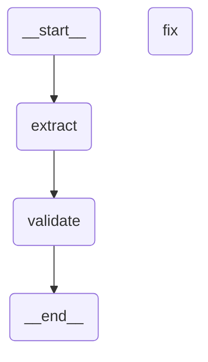

# Extraction reflection graph

Generated by `backend/scripts/draw_graph.py`. Do not hand-edit the diagram.

## Nodes

- `extract`: one LLM call with the extraction template (attempt +1).
- `validate`: strict `_parse` (fence-strip, JSON, Pydantic, server-side
  `is_target_brand`/domains). Success stores `result`; failure stores the
  `validation_error` string.
- `fix`: one LLM call with the repair template built from the last output
  plus its validation error (attempt +1).

## Edges

- `extract` → `validate` always.
- `validate` → END when `result` is set (success).
- `validate` → END when `attempts >= 3` (budget exhausted,
  degrades to `failed_extraction`).
- Otherwise `validate` → `fix` → `validate` (critique loop).
